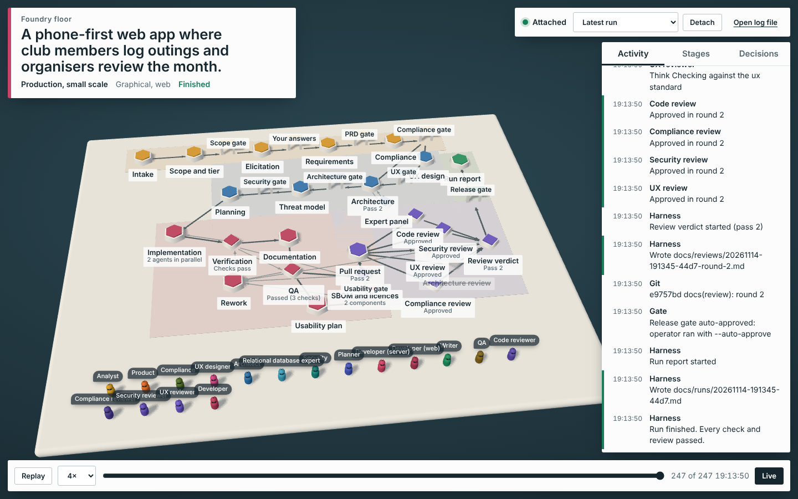
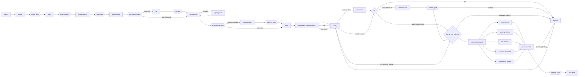

# Foundry

A reusable multi-agent harness for building software. You describe what you want; a graph of
specialised agents takes it from requirements through architecture, UX, implementation, and
AI peer review to a pull request, with a human approving at the points that matter and every
step written to a tamper-evident audit trail.



## What it gives you

- **A real workflow graph.** 35 nodes on [LangGraph](https://github.com/langchain-ai/langgraphjs):
  deterministic routing, checkpointed state, resumable runs, parallel builders and reviewers. The model never
  decides what happens next; code does.
- **Requirements and architecture taken seriously.** The analyst asks clarifying questions before
  anything is written. The PRD has numbered, testable requirements. Every architectural choice
  becomes a decision record with the options that were rejected.
- **UX first for anything graphical.** The UX specification is written and approved before the
  architecture, and a dedicated UX reviewer checks the pull request against it.
- **Process that scales with the job.** Three tiers decide which stages, gates, standards and
  reviewers apply. A prototype stays a small monolith with no auth; a small production tool gets
  every security standard and no load balancer.
- **Parallel build tracks.** The planner cuts the work by tier and platform (contract, database,
  server, web, iOS). A dispatcher runs independent tracks at the same time, each agent in its own
  git worktree, and picks the model for each task from its size and risk.
- **QA and usability as their own stages.** An independent QA agent traces every requirement to
  evidence before a pull request exists. A usability gate then waits for a test with real people.
- **Compliance in the pipeline.** A compliance analyst decides from the requirements which
  regimes apply (GDPR, HIPAA, PCI DSS and others) and their control packs are added to design,
  build, QA and review only when they do. Every project, at every tier, gets an SBOM checked
  against the EU baseline, a licence policy check, and generated third-party notices.
- **Domain experts on call.** The architect can have specialists (databases, caching, messaging,
  HTTP, RPC, real-time) challenge specific decisions on a draft before the design is final.
- **Model-agnostic agents.** Each role maps to a runner: the Claude Agent SDK, any coding-agent
  CLI, or any chat model LangChain can initialise. Use a different vendor for review than for
  development.
- **AI peer review that cannot be skipped.** Reviewers run in fresh contexts, in parallel, one per
  lens, and optionally several vendors per lens (`review.ensemble`), any of which can block. Blocking findings loop back to the developer. A second, independent review runs in CI.
- **An audit trail you can verify.** Every node, tool call, artifact, decision, gate and verdict is
  an event in a hash-chained log that is exported into the pull request.
- **A 3D floor you can attach and detach.** Watch agents move between stations as they work, or
  scrub back through any finished run.

Defaults: **Rust** for native and embedded, **TypeScript** for web, and each mobile platform's native language (**Swift** on iOS, **Kotlin** on Android). Performance is the goal: the architect picks the platform's own mature, documented, security-tested frameworks first, prefers vanilla, and must justify every third-party dependency and set a performance budget. Official platform guidelines such as Apple's Human Interface Guidelines are mandatory inputs: designs must name the ones they follow, and reviewers check against them.

## Quick start

Requires Node 22 or newer and git.

```bash
npm install
npm run build
npm test

# See the whole thing work offline, with mock agents, in the 3D viewer:
npm run demo            # then open http://127.0.0.1:4317
```

Use it on a real project:

```bash
npm link -w @foundry/harness          # puts `foundry` on your PATH

cd ~/code/some-project
foundry init                          # config, CI review workflow, PR template
foundry run "A CLI that syncs two folders over SSH" --viewer
```

The default runner is the Claude Agent SDK, which needs `ANTHROPIC_API_KEY` (or an existing
Claude Code login). Pull requests need an `origin` remote and an authenticated `gh`.

| Command | What it does |
|---|---|
| `foundry run "<request>"` | Start a run. `--tier` fixes the tier, `--auto-approve` runs unattended, `--viewer` serves the 3D floor, `--gates file` takes gate decisions from JSON files so someone other than the terminal's owner can answer. |
| `foundry resume <runId>` | Continue a run after a crash or a closed terminal, from its last checkpoint. `--replan "note"` discards the remaining plan and plans again from the approved designs. |
| `foundry runs` | List runs in this project. |
| `foundry tiers` | Show what each tier requires. |
| `foundry audit verify <runId or file>` | Check the hash chain of an audit log. |
| `foundry audit show <runId> --type gate` | Read the log, filtered by event type. |
| `foundry viewer` | Serve the viewer for this project without starting a run. |
| `foundry demo` | Full offline run with mock agents. |

## The workflow



Gates are where a human decides. At each one you approve or send the work back with feedback.
The harness opens a draft pull request and never merges it; that stays with you.

### Scale tiers

| | Prototype | Production, small scale | Production, at scale |
|---|---|---|---|
| Intent | Prove an idea, internal tool | Real users, low volume | High traffic or high consequence |
| Shape | One deployable unit | Modular monolith, single node | Layered, horizontally scaled |
| Auth and isolation | Out of scope | Required | Required, plus zero trust between services |
| Load balancers, queues, sharding | No | Only with a decision record | Required and reviewed |
| UX and clean-code standards | Full | Full | Full |
| Threat model | No | Yes | Yes |
| Human gates | Scope, PRD, usability | Scope, PRD, compliance, UX, architecture, security, usability, release | Same |
| Compliance assessment | Runs; auto-approved | Runs; a person confirms it | Same |
| SBOM, licence check, notices | Yes | Yes, and gaps against the EU baseline block release | Same |
| Domain experts per design (max) | 2 | 4 | 6 |
| QA | Critical flows; gaps listed as not run | Every functional requirement needs a pass | Same |
| Testing and delivery | Light unit tests, one verify command | Unit, integration, UI, one load test, CI, scripted deploy | Plus contract, resilience, repeatable load, automated delivery |
| Review lenses | Code, UX | Code, security, UX, compliance | Code, security, UX, architecture, compliance |
| Clarifying questions (max) | 3 | 7 | 12 |

The analyst proposes a tier and you confirm or change it at the first gate. Tiers are data in
[`packages/harness/src/tiers.ts`](packages/harness/src/tiers.ts).

### Roles and standards

Twelve roles, each a markdown prompt in [`packages/harness/assets/roles`](packages/harness/assets/roles):
analyst, product, compliance, UX, architect, expert, security, planner, developer, QA, reviewer, writer.
Domain experts are briefs in [`packages/harness/assets/experts`](packages/harness/assets/experts); add a
markdown file there, or under `.foundry/experts/` in a project, to add one. A domain with no file gets a generic brief.

Each role is held to the standards that apply to it at the current tier, from
[`packages/harness/assets/standards`](packages/harness/assets/standards): stack policy, clean code,
UX, documentation, review, security (baseline or production), architecture (one per tier), Rust,
TypeScript.

To change either for one project, put a file with the same name in that project under
`.foundry/roles/` or `.foundry/standards/`.

## Configuration

`foundry init` writes a commented `foundry.config.yaml`. The part that matters most:

```yaml
runners:
  claude:
    type: claude-agent-sdk
  second-opinion:
    type: chat
    model: "openai:<model-name>"     # npm i @langchain/openai
roles:
  default: claude
  reviewer: second-opinion           # review by a different model than the author
```

Parallelism and model choice are decided by the dispatcher, in code, from the plan:

```yaml
dispatch:
  maxParallel: 3            # developer agents at once, one per track
  bySize:                   # high-risk tasks are treated as large
    small: fast-model
    large: strongest-model
  byTrack:                  # wins over bySize
    ios: claude
    web: codex-dev
review:
  ensemble: [claude, codex-review]   # every lens reviewed by each, in parallel
```

Every dispatch decision (which tasks, how many agents, which runner and why) is an audit event.

| Runner | Workspace access | Audit detail | Use for |
|---|---|---|---|
| `claude-agent-sdk` | Reads and edits files, runs commands | Every tool call, policy enforced by hooks | Any role; the best-audited choice for developer |
| `cli` | Whatever the CLI does | Its output and the resulting diff | Developer on another vendor's coding agent |
| `chat` | None; the harness inlines context and writes files | Request and reply | Analyst, product, UX, architect, security, planner, writer, reviewer |
| `mock` | Writes placeholder files | Simulated | Tests and the demo |

## Audit trail and decision log

Each run produces, inside the target project:

| Path | Contents |
|---|---|
| `.foundry/runs/<id>/events.jsonl` | The live, append-only event log |
| `docs/runs/<id>.md` | Run report: gates and who decided, clarifications, artifacts, reviews |
| `docs/runs/<id>.events.jsonl` | The finished log, committed with the pull request |
| `docs/decisions/NNNN-*.md` | One decision record per significant choice |
| `docs/compliance/COMPLIANCE-ASSESSMENT.md` | Data inventory, which regimes apply and why, obligations |
| `sbom/bom.cdx.json` | The SBOM: CycloneDX 1.6, with licences and SHA-512 hashes |
| `docs/compliance/SBOM-REPORT.md` | EU baseline checks and licence policy results |
| `THIRD-PARTY-NOTICES.md` | Attribution list generated from the SBOM |
| `docs/architecture/EXPERT-REVIEW.md` | What each domain expert said about the draft design |
| `docs/qa/<id>-round-N.md` | QA report: requirement traceability, evidence, defects |
| `docs/ux/USABILITY-TEST.md` | The usability test plan for the human gate |
| `docs/reviews/<id>-round-N.md` | Every AI review round, also posted to the PR |
| `docs/product`, `docs/ux`, `docs/architecture`, `docs/security`, `docs/plan` | The design documents |

Every event carries the SHA-256 of the one before it. Editing or removing any line makes
`foundry audit verify` fail at that line. Secrets matching common token patterns are redacted
before they are written. Every harness commit carries `Foundry-Run` and `Foundry-Node` trailers.

## The viewer

`foundry run --viewer`, `foundry viewer`, or `foundry demo`, then open the printed address.

- Stations are graph nodes, grouped by phase. Arches are human gates and turn amber when one is
  waiting on you. Pieces are agents; they walk to the station they are working at.
- **Attach / Detach** connects or disconnects the viewer. The viewer only reads the event log, so
  it cannot slow down, change, or break a run.
- The timeline replays or scrubs any run. **Open log file** loads an exported `.events.jsonl`,
  for example one from a pull request.
- The **Stages** tab lists everything on the board as text, for keyboard and screen-reader use.

## Compliance

- **What it is not.** The assessment is an AI agent's working position, not legal advice, and the
  SBOM checks are a subset of the EU baseline, not a certification. At production tiers a person
  must confirm the assessment at its own gate.
- **Applicability.** Decided from the data the product handles and who uses it. A regime found
  not to apply is recorded with what would change that, so a scope change triggers a reassessment.
- **Control packs.** GDPR, US state privacy, HIPAA, PCI DSS, children's data and the EU Cyber
  Resilience Act each have a pack under `assets/standards/compliance-*.md`, loaded only when the
  regime applies. Each names the established tool for the job, for example a payment provider's
  hosted fields so card numbers never reach your systems.
- **SBOM.** Generated by OWASP cdxgen (installed, or through `npx`) as CycloneDX 1.6 JSON, then
  checked by the harness against the baseline in BSI TR-03183-2 v2.1.0: creator and timestamp, and
  for each component a name, version, licence and SHA-512 hash, with dependency relationships and
  no embedded vulnerability data. Set `compliance.sbom.creator` to a name with an email or URL.
- **Licences.** Shipped components are checked against `compliance.licenses`. A forbidden licence
  sends the work back once to replace the dependency, then escalates to the release gate.

## Safety model

- Agents never push, merge, publish, escalate privileges, or write outside the project. With the
  Claude runner this is enforced on every tool call and each denial is logged.
- The harness refuses to start on a dirty working tree and does all its work on a
  `foundry/<runId>` branch.
- The viewer server binds to localhost only.
- A reviewer's verdict is derived from the severity of its findings, so it cannot block on a nit
  or approve over a blocker.

## Known limits

- One pull request per run. Very large builds should be split into several runs.
- Parallel builders share nothing but git: each worktree installs its own dependencies, which costs time on large projects.
- The compliance packs are engineering checklists written from general knowledge of each regime. Have the person responsible for compliance review them before relying on them.
- The viewer board is crowded now that the graph has 35 nodes; it needs a layout pass.
- QA can only exercise what the machine can run. It records what it could not run (a physical phone, for example) instead of guessing.
- Gates are answered in the terminal or through response files (`--gates file`). The viewer shows them but cannot answer them yet.
- CLI runners are opaque to the policy hooks. Run them in a container or sandbox.
- The Claude, chat and CLI runners and the GitHub path are type-checked and unit-tested where
  possible, but the end-to-end tests run on the mock runner. Do a first real run on a throwaway
  project.

## Repository layout

```
packages/harness   the graph, runners, audit log, CLI, bridge
  src/graph.ts       the workflow
  src/tiers.ts       what each tier requires
  src/events.ts      hash-chained audit log
  assets/            role prompts, standards, project templates
packages/viewer    the 3D floor (Vite, three.js)
docs/decisions     why this harness is built the way it is
```
